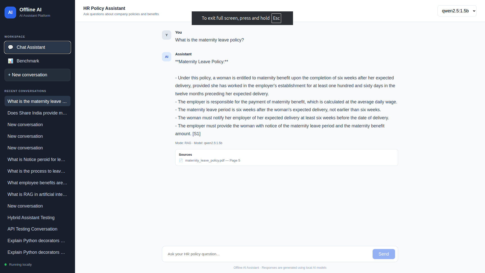
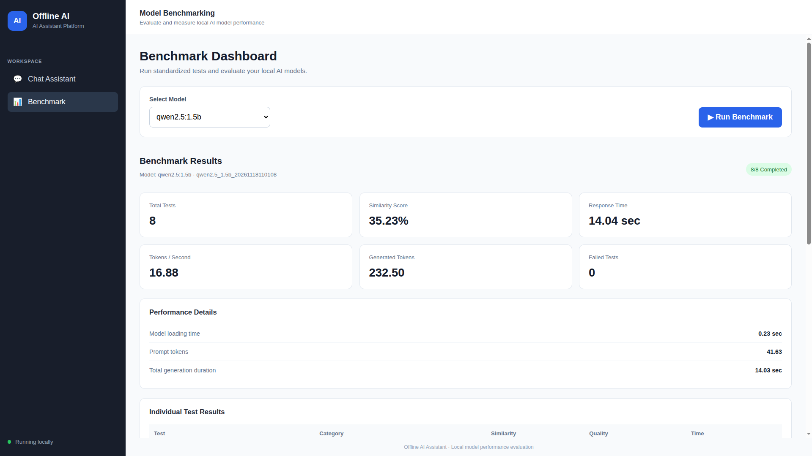
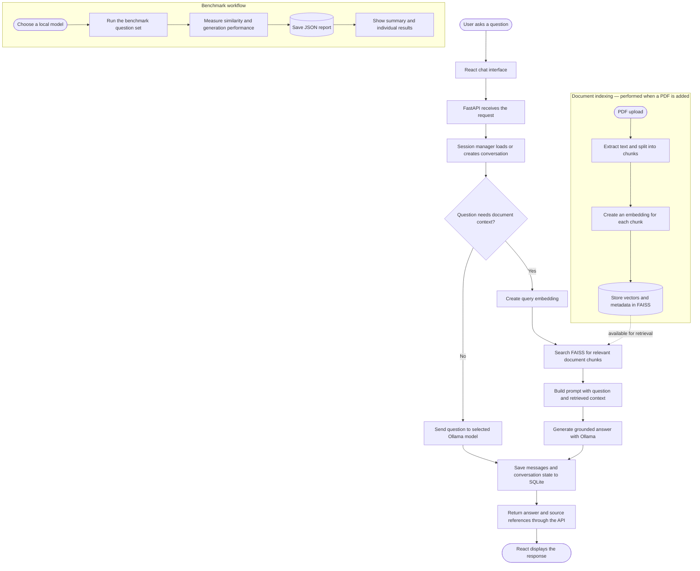

# 🧠 Offline AI Assistant

[](https://www.python.org/)
[](https://fastapi.tiangolo.com/)
[](https://react.dev/)
[](https://ollama.com/)
[](https://github.com/facebookresearch/faiss)

**Offline AI Assistant** is a local-first chat application for asking general questions and querying personal or company documents. It combines local models served by Ollama with retrieval-augmented generation (RAG), so document answers can include source references. The React interface also supports conversation history, model selection, document management, and model benchmarking.

---

## 📸 Interface Preview

### Chat Assistant

Ask a question about indexed documents and review the cited source files.



### Model Benchmark

Run the benchmark suite against a local model and inspect the summary and per-test metrics.



---

## ✨ Key Features

- **Hybrid assistant:** handles general chat with an Ollama model and uses RAG for document questions.
- **Document question answering:** uploads and indexes PDFs, retrieves relevant passages, and includes source references in answers.
- **Local conversation history:** stores conversations in SQLite on the user's machine.
- **Model management:** selects from models available in the local Ollama runtime.
- **Benchmark dashboard:** runs a standardized question set and reports similarity, response time, token throughput, and per-case results.
- **Local-first data:** documents, the FAISS index, conversations, and reports are stored locally.

---

## 🏗️ Architecture & Workflow



### Chat request flow

1. The browser sends a chat request to the FastAPI backend with the message, conversation ID, and optional model selection.
2. The session manager determines whether to answer as a general question or retrieve document context.
3. For a document question, the query is embedded and matched against the FAISS index. Retrieved passages are provided to the local language model to produce a grounded response.
4. The assistant response and conversation state are persisted in SQLite and returned to the browser. Document answers can include source names and page references.

### Document indexing flow

1. A PDF is uploaded through the documents API.
2. The document loader extracts its text and the chunker splits it into retrieval-sized passages.
3. An embedding model converts each passage into a vector, which is stored in the FAISS index for later search.

### Benchmark flow

1. Select an installed Ollama model in the dashboard.
2. The API runs the benchmark question set and records response quality and generation metrics.
3. The report is saved as JSON and can be opened later in the benchmark history view.

---

## 📂 Project Structure

```text
.
├── data/                              # Local documents, vector index, DB, reports
├── docs/images/                       # README interface screenshots
├── src/offline_ai_assistant/
│   ├── api/                            # FastAPI app, routes, request schemas
│   ├── assistant/                      # Chat engine, session and conversation state
│   ├── benchmark/                      # Benchmark runner, metrics, report storage
│   ├── core/                           # Local model management and LLM integration
│   ├── frontend/                       # React dashboard
│   └── rag/                            # Loading, chunking, embeddings, retrieval, FAISS
├── tests/                              # Backend tests
├── pyproject.toml                      # Python package and dependency configuration
├── requirements.txt                    # Alternative Python dependency list
└── uv.lock                             # Locked Python dependency versions
```

---

## 🧰 Technology Stack

- **Backend/API:** Python 3.14+, FastAPI, Uvicorn, Pydantic Settings
- **Local inference:** Ollama and locally installed language models
- **RAG:** LangChain text splitters, sentence-transformers/Ollama embeddings, FAISS
- **Document processing:** PyMuPDF and PDF/text loaders
- **Persistence:** SQLite for conversations; local files for documents, vector indexes, and benchmark reports
- **Frontend:** React 19, React Router, Axios, Recharts, Lucide
- **Development:** `uv`, npm, pytest, Ruff

---

## ⚙️ Installation & Setup

### Prerequisites

- Python 3.14 or newer
- [`uv`](https://docs.astral.sh/uv/)
- Node.js and npm
- [Ollama](https://ollama.com/) installed and running

Pull a model before using the assistant. For example:

```bash
ollama pull llama3.2:3b
```

The default chat model is `llama3.2:3b`. The embedding service also needs its configured embedding model available in Ollama (currently `nomic-embed-text`):

```bash
ollama pull nomic-embed-text
```

### Install Python dependencies

Run from the repository root:

```bash
uv sync
```

Optional local settings can be placed in `.env` (keep this file out of Git):

```dotenv
OLLAMA_BASE_URL=http://localhost:11434
OLLAMA_MODEL=llama3.2:3b
OLLAMA_TIMEOUT=120
LLM_TEMPERATURE=0.7
```

### Install frontend dependencies

```bash
cd src/offline_ai_assistant/frontend
npm ci
```

---

## 🚀 How to Run

Start the API from the repository root:

```bash
uv run uvicorn offline_ai_assistant.api.main:app --app-dir src --reload
```

In another terminal, start the web interface:

```bash
cd src/offline_ai_assistant/frontend
npm start
```

Open **http://localhost:3000**. The API listens at **http://127.0.0.1:8000** and its interactive documentation is available at **http://127.0.0.1:8000/docs**. Keep Ollama running while using the app.

To run the backend tests:

```bash
uv run pytest
```

Some tests call the local embedding service, so Ollama and the `nomic-embed-text` model must be available for the full suite to pass.

---

## 📊 Benchmark Results

The reports included in this checkout recorded eight successful cases and zero failures per run. The latest included Qwen 2.5 1.5B report recorded a 36.45% average similarity score, 14.49 seconds average response time, and 16.11 generated tokens/second. The latest included Llama 3.2 3B report recorded a 29.39% average similarity score, 31.77 seconds average response time, and 8.28 generated tokens/second.

These figures depend on the machine, model version, and benchmark data. The screenshot shows an earlier Qwen report with an 8/8 completion result.

---

## ⚠️ Current Limitations

- Ollama and the required models must be installed locally before inference works; internet access may be needed for initial setup and model downloads.
- The frontend API base URL is currently hard-coded in `src/offline_ai_assistant/frontend/src/App.js`.
- The full backend test suite requires a running Ollama service and available embedding model.
- `pyproject.toml` is the complete dependency definition used by `uv sync`; `requirements.txt` is currently a shorter list.
